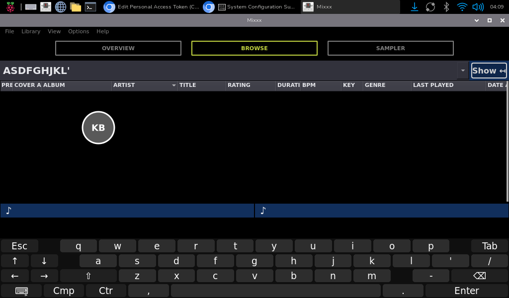

# Mixxx Touch Keyboard Overlay 🎛️⌨️

A touch-friendly on-screen keyboard for **Mixxx** on the **Raspberry Pi 5** (Raspberry Pi OS, **labwc** / Wayland). It stays visible on top of **fullscreen** Mixxx, so you can search your library or type anywhere else without leaving fullscreen.

A floating **KB** button toggles the keyboard. Both live on the Wayland **overlay** layer, which is above fullscreen windows.



## ✨ Features

- **Visible over fullscreen Mixxx**: both the button and the keyboard use the layer-shell `OVERLAY` layer.
- **Never steals focus**: the keyboard takes no keyboard focus, so the search box you tapped stays active while you type.
- **Works in any app**: keys are injected through `/dev/uinput`, not tied to Mixxx.
- **Full touch keyboard**: number row, Shift (tap once for one capital, twice for caps lock), `?123` symbols page, Esc, Tab, Enter, Backspace, space and arrow keys.
- **Hold-to-repeat** on Backspace and the arrow keys.
- **Find key**: sends `Ctrl+F` to jump to Mixxx's library search box.
- **Move key (⇅)**: flips the keyboard between the bottom and top of the screen.
- **Draggable button**: hold for 1 second (it turns blue), then drag it anywhere.
- **Single file**: no `wvkbd` and no helper scripts.

## 🎮 Button gestures

| Gesture | Action |
|---|---|
| Tap | Show / hide the keyboard |
| Hold 1 s, then drag | Move the button |
| Hold 3 s (no movement) | Quit the overlay |

Running the script a second time (for example from the start menu entry) stops the running copy, so the menu entry works as an on/off toggle.

## 🛠️ Installation

```bash
git clone https://github.com/djayza/Mixxx-touch-kb-overlay.git
cd Mixxx-touch-kb-overlay
chmod +x install.sh
./install.sh
```

Then **log out and back in** (or reboot). The `input` group membership that allows `/dev/uinput` only applies after a fresh login.

The installer does the following:

1. Installs `python3-gi`, `python3-gi-cairo`, `gir1.2-gtk-3.0`, `gir1.2-gtklayershell-0.1`, `python3-evdev` and `libnotify-bin`.
2. Loads the `uinput` module at boot and adds a udev rule so the `input` group can use `/dev/uinput`.
3. Adds your user to the `input` group.
4. Copies the script to `~/mixxx-osk/mixxx-osk.py`.
5. Adds a start menu entry (**Mixxx Touch Keyboard**).
6. Adds the script to `~/.config/labwc/autostart` and removes the old `mixxx-kb-menu-toggle.sh` line if present.

### Manual start

```bash
~/mixxx-osk/mixxx-osk.py
```

## ⌨️ Using it with Mixxx

1. Tap the library search box (or press **Find** on the keyboard).
2. Tap the **KB** button and type.
3. Tap **Hide** or the **KB** button to close the keyboard.

> ⚠️ If the search box is **not** focused, letter keys trigger Mixxx keyboard shortcuts (play, cue, and so on) instead of typing. Focus the box first.

## 🔧 Troubleshooting

| Problem | Fix |
|---|---|
| `Cannot open /dev/uinput` | Run `install.sh`, then log out and back in. Check with `groups` that `input` is listed. |
| Button doesn't appear | Run `~/mixxx-osk/mixxx-osk.py` in a terminal and read the error. Make sure you're in a Wayland labwc session. |
| Keys type the wrong characters | The key map assumes a **US** layout. Other layouts need the map in `mixxx-osk.py` adjusted. |
| Keyboard covers what I need | Press the **⇅** key to move it to the top of the screen. |
| `Failed to initialize layer surface` | Run with `LD_PRELOAD=/usr/lib/aarch64-linux-gnu/libgtk-layer-shell.so ~/mixxx-osk/mixxx-osk.py` |

## 📁 Files

| File | Purpose |
|---|---|
| `mixxx-osk.py` | The floating button and the keyboard |
| `install.sh` | Dependencies, permissions, menu entry and autostart |

## ℹ️ Why not `wvkbd`?

Earlier versions launched `wvkbd`, which draws on the layer-shell `TOP` layer. Fullscreen windows sit on that same layer, so the keyboard opened hidden behind Mixxx. This version draws its own keyboard on the `OVERLAY` layer, which is always above fullscreen windows.

## 📜 License <GPL-2.0>
